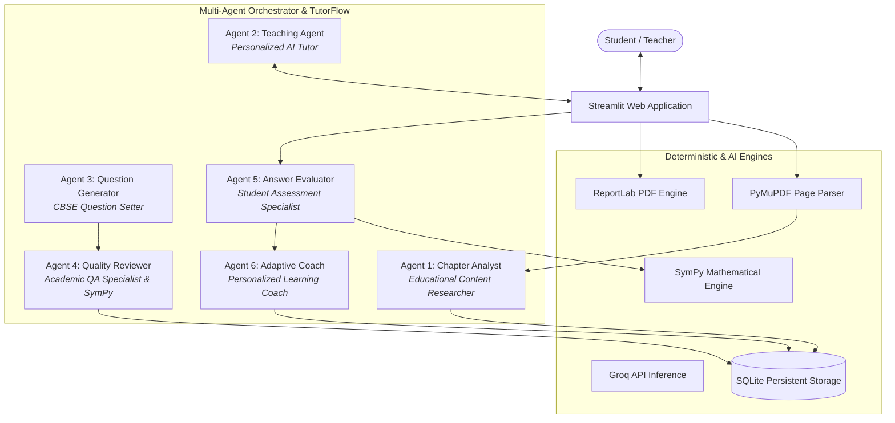

# Multi-Agent AI Tutor: AI-Powered Personalized Learning & Assessment Platform

A production-grade, modular, multi-agent AI educational platform designed for **CBSE Classes 6–12**. Students and educators can upload arbitrary chapter PDFs to extract concepts, generate verified exam-style questions, engage in grounded 1-on-1 AI tutoring, and track mastery progression through adaptive analytics.

---

## 🌟 Key Architecture & Multi-Agent Collaboration

The system coordinates six specialized agents modeled on CrewAI and educational design patterns:



### The 6 Specialized Agents
1. **Agent 1: Chapter Analysis Agent (`Educational Content Researcher`)**
   - Parses text, layout, bounding boxes, tables, formulas, and diagrams using PyMuPDF.
   - Discovers topic hierarchies, learning objectives, and detects low-confidence/scanned pages.
   - Retains page-level chunk references for zero-hallucination groundings.
2. **Agent 2: Personalized Teaching Agent (`Expert AI Tutor`)**
   - Delivers interactive lessons across three modes: *Explain Like I'm 10*, *Standard*, and *Detailed*.
   - Provides worked examples, interactive chat, and buttons for "Explain Again" and "Make It Simpler".
   - Restricts claims to uploaded chapter text and states when a query is out-of-scope.
3. **Agent 3: Question Generator Agent (`CBSE Question Setter`)**
   - Crafts authentic questions across all CBSE formats: MCQs, Fill-in-the-Blank, Numerical, True/False, Assertion-Reason, Short Answer, Long Answer, Matching, and Case Study.
   - Produces strictly validated Pydantic JSON with plausible distractors and solutions.
4. **Agent 4: Question Quality Reviewer Agent (`Academic QA Specialist`)**
   - Audits question clarity, verifies correct answers, checks distractor uniqueness.
   - Uses **SymPy** for deterministic mathematical calculation checks.
   - Rejects flawed questions with actionable feedback up to 3 revisions.
5. **Agent 5: Answer Evaluation Agent (`Student Assessment Specialist`)**
   - Evaluates submissions deterministically (without latency for objective items).
   - Normalizes units (e.g., `24 cm` == `24cm` == `24.0`) and evaluates algebraic equivalences.
   - Scores descriptive questions using grounded marking rubrics with partial credit.
6. **Agent 6: Adaptive Learning & Memory Agent (`Personalized Learning Coach`)**
   - Tracks mastery by topic: *Foundation* (<50%), *Standard* (50–79%), and *Mastery* (≥80%).
   - Generates targeted practice recommendations and adapts quiz difficulty.

---

## 🚀 Quickstart for Windows PowerShell

### 1. Clone & Enter Project Directory
```powershell
cd "c:\Users\SINDHU SURAJ\source\repos\Multi-Agent AI Tutor"
```

### 2. Set Up Virtual Environment (Optional but Recommended)
```powershell
python -m venv venv
.\venv\Scripts\Activate.ps1
```

### 3. Install Dependencies
```powershell
python -m pip install -r requirements.txt
```

### 4. Configure Groq API Key (Optional)
Create a `.env` file from the provided example:
```powershell
Copy-Item .env.example .env
```
Add your key inside `.env`:
```env
GROQ_API_KEY=gsk_your_actual_key_here
GROQ_MODEL=llama-3.3-70b-versatile
```
> **Note:** If no API key is configured, the application automatically runs in **Verified CBSE Offline Demo Mode** with complete interactive quiz taking, math validation, lesson browsing, and dashboard analytics out of the box!

### 5. Launch the Streamlit Application
```powershell
streamlit run app.py
```
The application will open automatically in your browser at `http://localhost:8501`.

---

## 🧪 Running Automated Tests

Run the comprehensive pytest suite to verify document extraction, question schemas, SymPy math normalizers, quiz state flow, and student memory:

```powershell
python -m pytest tests/ -v
```

All 9 test suites cover:
- `test_pdf_processing.py`: PyMuPDF layout analysis and metadata chunking.
- `test_question_validation.py`: Pydantic 4-option MCQ enforcement and reviewer math checks.
- `test_grading.py`: SymPy numerical normalization (`144 m^2` == `144.0` == `288/2`), fraction arithmetic (`11/15`), and rubric evaluation.
- `test_quiz_flow.py`: Generation-to-evaluation pipeline and locked attempt recording.
- `test_student_memory.py`: Multi-student isolation, mastery scores, and history clearing.

---

## 📚 Sample Reference Material Included

Pre-generated NCERT-style reference chapters are provided in `sample_data/`:
1. `ncert_class6_perimeter_and_area.pdf`: NCERT Chapter 6 with definitions, formulas, worked examples, and geometric figures.
2. `ncert_class6_fractions.pdf`: NCERT Chapter 7 covering proper/improper fractions, equivalent fractions, and unlike addition.
3. `class6_perimeter_area_worksheet.pdf`: 8-question practice worksheet across all difficulty levels.
4. `class6_math_practice_paper_sections_a_e.pdf`: Full CBSE blueprint examination paper (Sections A through E).

---

## 🎓 Teacher Tools & Document Exports
- **CBSE Examination Paper Generator**: Build customized papers with Section A (1M), Section B (2M), Section C (3M), Section D (5M), and Section E (4M Case Study).
- **ReportLab PDF Exporters**:
  - Export clean Student Examination Papers.
  - Export official Teacher Answer Keys with complete marking rubrics.
- **CSV Data Exporter**: Export student question attempts and scores for offline gradebook tracking.
